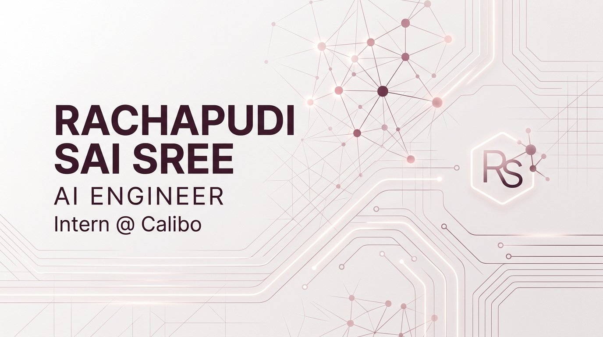

<!-- ============================================================ -->
<!--   RACHAPUDI SAI SREE — PROFESSIONAL GITHUB PROFILE README     -->
<!--   Visual Identity: Clean Light Tech (Cobalt #2563EB & Cyan #0EA5E9) -->
<!-- ============================================================ -->

  

<!-- Accessibility & Static Fallback -->
<noscript>
  <h1>Rachapudi Sai Sree</h1>
  
<strong>AI Engineer Intern @ Calibo | Software Developer | AI/ML &amp; Backend Engineering</strong>

  
B.Tech Computer Science and Engineering &bull; K L University (2023–2027) &bull; CGPA: 9.82

</noscript>

  
  
  
  

---
