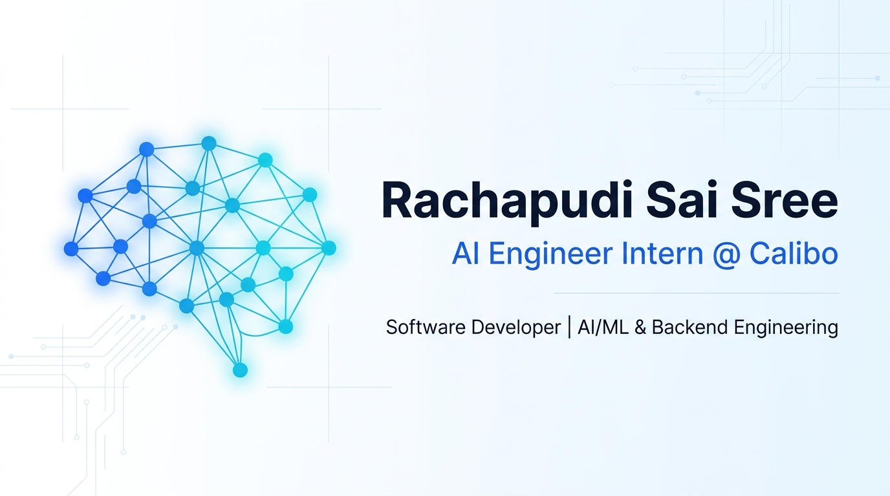

<!-- ============================================================ -->
<!--   RACHAPUDI SAI SREE — PROFESSIONAL GITHUB PROFILE README     -->
<!--   Visual Identity: Clean Light Tech (Cobalt #2563EB & Cyan #0EA5E9) -->
<!-- ============================================================ -->

<div align="center">

<p align="center">
  <a href="https://github.com/SAI30570SREERachapudi">
    
  </a>
</p>

<!-- Accessibility & Static Fallback -->
<noscript>
  <h1>Rachapudi Sai Sree</h1>
  <p><strong>AI Engineer Intern @ Calibo | Software Developer | AI/ML &amp; Backend Engineering</strong></p>
  <p>B.Tech Computer Science and Engineering &bull; K L University (2023–2027) &bull; CGPA: 9.82</p>
</noscript>

<p align="center">
  <a href="mailto:saisreerachupudi@gmail.com">
    
  </a>
  <a href="https://linkedin.com/in/rachapudi-sai-sree-313305388">
    
  </a>
  <a href="https://github.com/SAI30570SREERachapudi">
    
  </a>
  
</p>

</div>

---

### 📋 Executive Summary

```yaml
Name: Rachapudi Sai Sree
Current Role: AI Engineer Intern @ Calibo
Education: B.Tech in Computer Science & Engineering (K L University, 2023–2027)
Academic Standing: CGPA 9.82 | University 3rd Rank | NPTEL Discipline Star
Core Focus: Agentic AI Systems, Backend Engineering, Cloud Deployments & MLOps
Location: Nandyal, Andhra Pradesh, India
```

---

## 🧭 About Me

I am a Computer Science and Engineering undergraduate at **K L University** and currently working as an **AI Engineer Intern at Calibo**.

My core technical interest lies in bridging the gap between theoretical AI and dependable software engineering. Rather than treating AI as a black box, I focus on engineering practical, agentic AI-powered applications, resilient backend architectures, and reliable deployment workflows. 

Through my hands-on coursework and internship experience, I continuously deepen my capabilities across **AI engineering, backend development, cloud technologies, and DevOps**. I place a strong emphasis on clean code structure, data structures and algorithms, system design fundamentals, and continuous learning through hands-on implementation.

---

## 💼 Current Experience

### **AI Engineer Intern &mdash; Calibo**
*Current Professional Internship*

- **Agentic AI & Workflow Orchestration:** Building and exploring agentic architectures utilizing **LangGraph** to construct stateful, multi-step ReAct (Reasoning and Action) loops for automated workflows.
- **Tool Protocol Integration:** Standardizing external tool execution via the **Model Context Protocol (MCP)**, connecting disconnected standard-I/O tool servers (research, document formatting, and web inspection) to language model backends.
- **High-Speed Backend Services:** Engineering asynchronous **FastAPI** microservices and integrating high-throughput LLM inference backends (such as Groq Llama-3.3-70b) for reliable tool-calling and plan formulation.
- **Engineering Best Practices:** Adhering to strict privacy boundaries, decoupled service contracts, clean API specifications, and modular software design principles.

---

## 🎓 Education & Academic Achievements

<table>
  <tr>
    <td width="65%" valign="top">
      <h4>🏛️ K L University</h4>
      <p><strong>Bachelor of Technology — Computer Science and Engineering</strong><br />
      <em>July 2023 &ndash; May 2027</em><br />
      <strong>Academic CGPA:</strong> <code>9.82 / 10.0</code> (as stated in official academic records)</p>
      <h5>🏆 Verified Academic Distinctions</h5>
      <ul>
        <li><strong>University 3rd Rank:</strong> Ranked 3rd across the university cohort during my academic journey.</li>
        <li><strong>NPTEL Discipline Star:</strong> Recognized as an NPTEL Discipline Star for sustained excellence in computer science certifications.</li>
      </ul>
    </td>
    <td width="35%" valign="top">
      <h4>📚 Foundation Education</h4>
      <p><strong>Rao’s Junior College</strong><br />
      <em>MPC &bull; State Board</em><br />
      July 2021 &ndash; April 2023<br />
      <strong>Result:</strong> <code>98.5%</code></p>
      <hr />
      <p><strong>Sree Lakshmi English Medium High School</strong><br />
      <em>State Board</em><br />
      June 2020 &ndash; April 2021<br />
      <strong>Result:</strong> <code>97.0%</code></p>
    </td>
  </tr>
</table>

---

## 🚀 Featured Software & AI Projects

### 1. [Auto-PPT-Agent](https://github.com/SAI30570SREERachapudi/Auto-PPT-Agent)
> **Autonomous Presentation Generation Platform via LangGraph & MCP** &bull; `Completed`

- **The Problem:** Designing comprehensive presentations from raw topic inputs traditionally demands manual research, synthesis, and layout formatting.
- **My Technical Contribution:** Architected an autonomous agentic application utilizing a LangGraph ReAct loop. Integrated Groq Llama-3.3-70b for high-speed planning and tool selection, paired with disconnected Model Context Protocol (MCP) standard-I/O servers for web retrieval and PPT generation. Built a FastAPI asynchronous backend and a modern React + Vite frontend client.
- **Verified Technologies:** `Python` &bull; `LangGraph` &bull; `MCP (Model Context Protocol)` &bull; `FastAPI` &bull; `Groq API` &bull; `React` &bull; `Vite` &bull; `Tailwind/CSS`
- **Repository:** [`github.com/SAI30570SREERachapudi/Auto-PPT-Agent`](https://github.com/SAI30570SREERachapudi/Auto-PPT-Agent)

---

### 2. [MLOps CI/CD Pipeline](https://github.com/SAI30570SREERachapudi/MLOpsCICD)
> **Automated Machine Learning Lifecycle, Drift Detection & Canary Deployments** &bull; `Completed`

- **The Problem:** Real-world machine learning models suffer from data drift and performance degradation in production without automated quality gates and monitoring.
- **My Technical Contribution:** Implemented an end-to-end MLOps pipeline covering automated model training (`train.py`), rigorous multi-stage validation (`validate.py`), data and prediction drift detection (`drift_detect.py`), and continuous production monitoring (`monitor.py`). Configured GitHub Actions workflows (`ci_pipeline.yml`, `cd_deploy.yml`) with automated canary deployment strategies and retraining triggers.
- **Verified Technologies:** `Python` &bull; `Scikit-learn` &bull; `NumPy` &bull; `GitHub Actions` &bull; `CI/CD Automation` &bull; `Canary Deployment`
- **Repository:** [`github.com/SAI30570SREERachapudi/MLOpsCICD`](https://github.com/SAI30570SREERachapudi/MLOpsCICD)

---

### 3. [InsurAI](https://github.com/SAI30570SREERachapudi/InsurAI)
> **AI-Driven Insurance Evaluation & Claims Processing Architecture** &bull; `Completed`

- **The Problem:** Insurance workflows frequently encounter friction during claim evaluation and policy validation due to manual assessment bottlenecks.
- **My Technical Contribution:** Designed and implemented a full-stack platform featuring decoupled frontend (`insurance-frontend`) and backend (`insurancebacked`) architectures. Engineered policy evaluation endpoints, structured request validation, and authored comprehensive technical documentation and system architecture reports.
- **Verified Technologies:** `JavaScript` &bull; `Python` &bull; `RESTful APIs` &bull; `HTML5/CSS3` &bull; `System Documentation`
- **Repository:** [`github.com/SAI30570SREERachapudi/InsurAI`](https://github.com/SAI30570SREERachapudi/InsurAI)

---

### 4. [LeaseLinker AWS Deployment](https://github.com/SAI30570SREERachapudi/LeaseLinker-Deployment-in-AWS)
> **Cloud-Deployed Property & Lease Management Infrastructure** &bull; `Completed`

- **The Problem:** Landlords and property managers require centralized, multi-role platforms for tenant agreements, rent tracking, and timely automated notifications.
- **My Technical Contribution:** Developed and deployed a property management service incorporating a Java backend (`leaselinker2.war`) and interactive client frontend. Configured role-based access control (Admin, Landlord, Tenant), automated rent reminder tracking, and cloud provisioning on Amazon Web Services (AWS).
- **Verified Technologies:** `Java` &bull; `JavaScript` &bull; `AWS (Amazon Web Services)` &bull; `Docker` &bull; `REST APIs` &bull; `RBAC`
- **Repository:** [`github.com/SAI30570SREERachapudi/LeaseLinker-Deployment-in-AWS`](https://github.com/SAI30570SREERachapudi/LeaseLinker-Deployment-in-AWS)

> **Implementation Note on Specialized Architectures:**  
> Algorithmic investigations (including financial fraud explainability services with guardrails and credit score evaluators) represent specialized prototypes and internal experiments that directly inform my backend and explainability design principles.

---

## 🛠️ Technical Skills & Tooling

<div align="center">

| Domain | Verified Technologies & Tools |
| :--- | :--- |
| **Programming Languages** |     |
| **AI & Agentic Systems** |      |
| **Backend & Microservices** |      |
| **Cloud & DevOps** |      |
| **Databases & Tooling** |     |
| **Core Engineering** | `Data Structures & Algorithms` &bull; `Object-Oriented Design` &bull; `System Design Fundamentals` &bull; `Model Drift Monitoring` |

</div>

---

## 📈 Engineering Activity & Metrics

<div align="center">

### GitHub Contribution Telemetry
<p align="center">
  
</p>

<br />

<table>
  <tr>
    <td width="55%" align="center">
      
    </td>
    <td width="45%" align="center">
      
    </td>
  </tr>
</table>

</div>

---

## 📬 Contact & Professional Profiles

<div align="center">

I welcome professional discussions regarding AI engineering, backend architecture, open-source collaborations, and developer opportunities.

| Platform | Channel | Link |
| :--- | :--- | :--- |
| **Email** | `saisreerachupudi@gmail.com` | [Send Email](mailto:saisreerachupudi@gmail.com) |
| **LinkedIn** | `in/rachapudi-sai-sree-313305388` | [Connect on LinkedIn](https://linkedin.com/in/rachapudi-sai-sree-313305388) |
| **GitHub** | `@SAI30570SREERachapudi` | [View GitHub Profile](https://github.com/SAI30570SREERachapudi) |
| **Location** | Nandyal, Andhra Pradesh, India | &mdash; |

</div>

---

<div align="center">

<p align="center">
  
</p>

<p align="center">
  <em>Dedicated to building robust systems, mastering scalable architectures, and advancing through practical engineering.</em>
</p>

</div>
